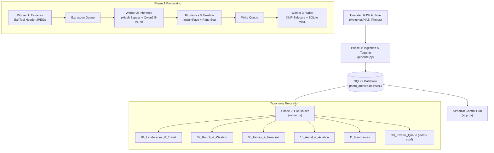

# AI-Powered RAW Photo Archival System (v2.0)
## System Architecture & Autonomous Execution Plan

### Executive Summary
The **AI-Powered RAW Photo Archival System** is a decoupled, local-first multi-threaded pipeline designed to autonomously process, classify, and organize 50,000+ uncataloged medium-format and full-frame RAW photographs (Phase One `.IIQ`, Nikon `.NEF`, Sony `.ARW`, Canon `.CR2`/`.CR3`, `.DNG`). 

The architecture eliminates API rate limits and token costs by running local Vision-Language Models (`qwen2.5-vl:7b` via Ollama) and camera header preview extraction via `ExifTool`.

---

### End-to-End Pipeline Architecture



---

### Implemented Project Components

The codebase includes:

1. **[`pipeline.py`](pipeline.py)**:
   - **Multi-threaded producer-consumer queues** (`extraction_queue`, `write_queue`) with bounded memory ceilings.
   - **ExifTool preview extraction** avoiding heavy RAW demosaicing.
   - **Perceptual Hashing (`imagehash.phash`)**: Burst frames within 4 Hamming distance inherit metadata without redundant GPU inference.
   - **VRAM Flush Protocol**: Forces Ollama model memory cleanup every 1,000 frames to prevent macOS memory leaks.
   - **Phase One IIQ Patch**: Uses `.IIQ.xmp` naming convention required by Capture One and Lightroom.

2. **[`router.py`](router.py)**:
   - Evaluates the 12-Bucket Taxonomy priority matrix.
   - Routes low confidence items ($<0.70$) into `99_Review_Queue`.
   - Atomic moves with 3-loop retry decorator to survive transient network drive disconnects.

3. **[`app.py`](app.py)**:
   - Streamlit dashboard providing real-time KPI metrics, category charts, country breakdowns, and an interactive review queue inspector.

4. **[`dry_run.py`](dry_run.py)**:
   - Standalone test harness with synthetic data covering Wyoming ranch shots, Iceland expeditions, aerial captures, family portraits, and panoramas.

5. **[`config/directive.txt`](config/directive.txt)**:
   - Ontological rules and historical context guiding the VLM inference.

6. **[`config/settings.yaml`](config/settings.yaml)**:
   - Centralized configuration for storage paths, models, thresholds, and taxonomy mappings.

7. **[`setup.sh`](setup.sh)**:
   - Automated environment builder and dependency verification script.

---

### Step-by-Step Execution Guide

```bash
# 1. Navigate to the project directory
cd ~/.gemini/antigravity/scratch/raw-photo-archival-system

# 2. Run automated environment setup
./setup.sh

# 3. Launch the dashboard to monitor progress
streamlit run app.py

# 4. In a separate terminal, launch the ingestion pipeline
python3 pipeline.py

# 5. When ingestion completes, execute physical taxonomy routing
python3 router.py
```
