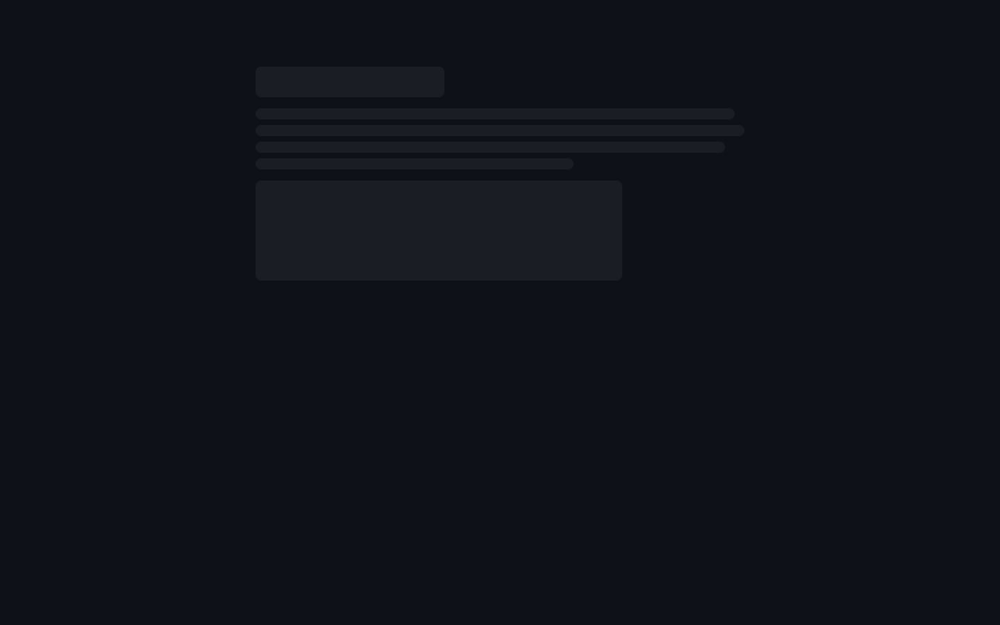

# 📸 AI-Powered RAW Photo Archival System (v2.0)

[](https://python.org)
[](https://streamlit.io)
[](https://insightface.ai)
[](https://exiftool.org)
[](https://sqlite.org)
[](#)

Production-grade, unattended local archival and metadata enrichment pipeline for massive professional RAW collections (Phase One `.IIQ`, Nikon `.NEF`, Sony `.ARW`, Canon `.CR2`/`.CR3`, `.DNG`). Employs local vision language models, biometric facial recognition, perceptual deduplication, and atomic file routing.

---

## 🖥️ Live Control Hub



*Streamlit Control Hub: Live real-time progress monitor, taxonomy distribution breakdown, confidence ratings, and review queue.*

---

## 🏗️ Architectural Overview

```
                      +----------------------------------------+
                      |       Unsorted RAW Archive (NAS)       |
                      +-------------------+--------------------+
                                          |
                                          v
                    +--------------------------------------------+
                    |           Phase 1: pipeline.py             |
                    +---------------------+----------------------+
                                          |
                  +-----------------------+-----------------------+
                  |                       |                       |
                  v                       v                       v
          Worker 1: Extractor     Worker 2: Inference     Worker 3: Writer
         (ExifTool Header JPEGs)  (Qwen2.5-VL 7B / pHash) (IPTC / .xmp Sidecars)
                  |                       |                       |
                  +-----------------------+-----------------------+
                                          |
                                          v
                              +-----------------------+
                              | SQLite WAL Checkpoint |
                              +-----------+-----------+
                                          |
                                          v
                             +-------------------------+
                             |   Phase 2: router.py    |
                             |  (12-Bucket Taxonomy)   |
                             +------------+------------+
                                          |
                                          v
                             +-------------------------+
                             |  Streamlit Control Hub  |
                             |        (app.py)         |
                             +-------------------------+
```

---

## 📁 Repository Structure

```
raw-photo-archival-system/
├── config/
│   ├── directive.txt        # System prompt with Wyoming Ranch, Iceland & European lore
│   └── settings.yaml        # Mount paths, model parameters, thresholds & taxonomy
├── data/
│   └── photo_archive.db     # SQLite WAL tracking database
├── cache/                   # Temporary extracted preview JPEGs (auto-pruned)
├── logs/                    # pipeline.log, router.log, errors.log
├── reference_faces/         # Reference portrait JPEGs for biometric face recognition
├── pipeline.py              # Phase 1: Multi-threaded Ingestion, VLM & XMP sidecar engine
├── router.py                # Phase 2: Atomic physical relocation with NAS retry loops
├── app.py                   # Streamlit live progress & review queue web dashboard
├── dry_run.py               # Test simulator & mock database seeder
├── requirements.txt         # Complete Python dependencies
├── setup.sh                 # Environment setup and dependency health check
└── README.md                # System documentation & Lightroom ingestion guide
```

---

## ⚡ Quickstart

### 1. Run Setup & Verification
```bash
./setup.sh
```

### 2. Verify with Simulated Data
```bash
# Seed realistic mock test records
python3 dry_run.py

# Test 12-Bucket taxonomy relocation in dry-run mode (no files moved)
python3 router.py --dry-run
```

### 3. Launch the Control Center Dashboard
```bash
streamlit run app.py
```
Open [http://localhost:8501](http://localhost:8501) to monitor live throughput, taxonomy distributions, confidence scores, and inspect low-confidence images.

### 4. Run the Full Pipeline on your Archive
Ensure your NAS drive is mounted and paths in `config/settings.yaml` are configured:
```bash
# Phase 1: Tagging, VLM inference & XMP generation
python3 pipeline.py

# Phase 2: Physical relocation into 12-Bucket Taxonomy
python3 router.py
```

---

## 📸 Lightroom Classic Ingestion Protocol

Once `router.py` finishes organizing files on your NAS:
1. Open **Lightroom Classic**.
2. Go to **File -> Import Photos and Video...**
3. Select your organized root directory: `/Volumes/NAS_Photos/Organized Archive`
4. **CRITICAL:** Select **ADD** at the top center of the import window. *(Do not select Copy or Move).*
5. Lightroom will read all AI tags, locations, and biometric face tags directly from the Dublin Core `.xmp` and `.IIQ.xmp` sidecars.
